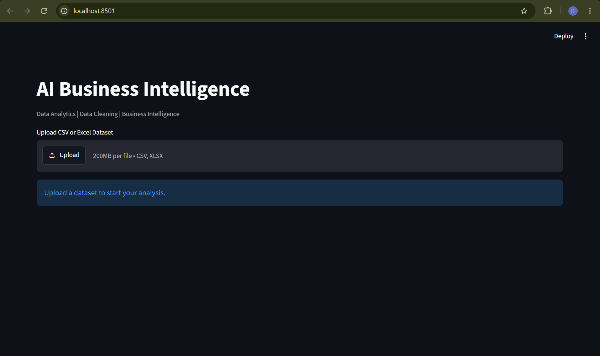
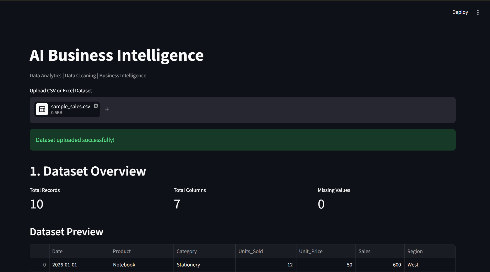
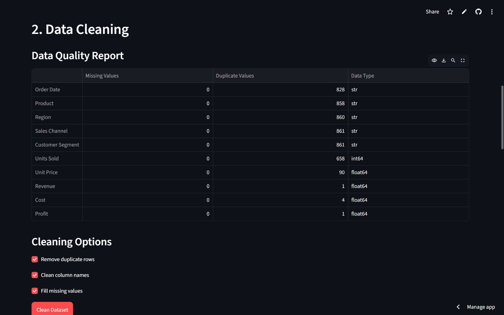
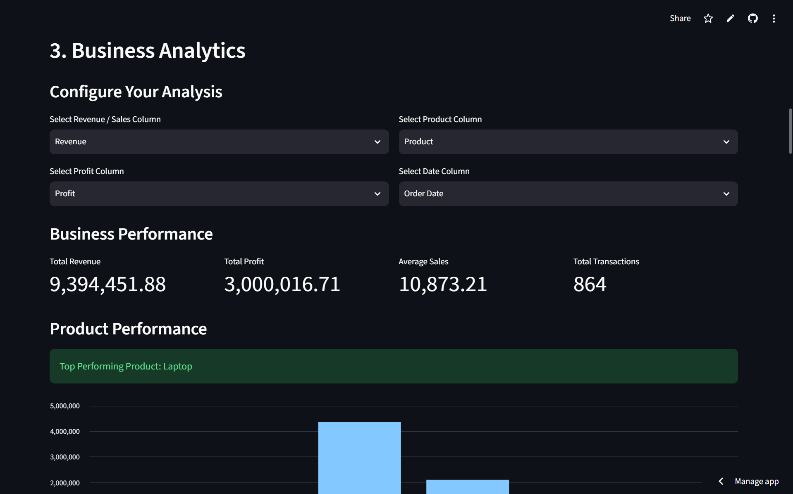
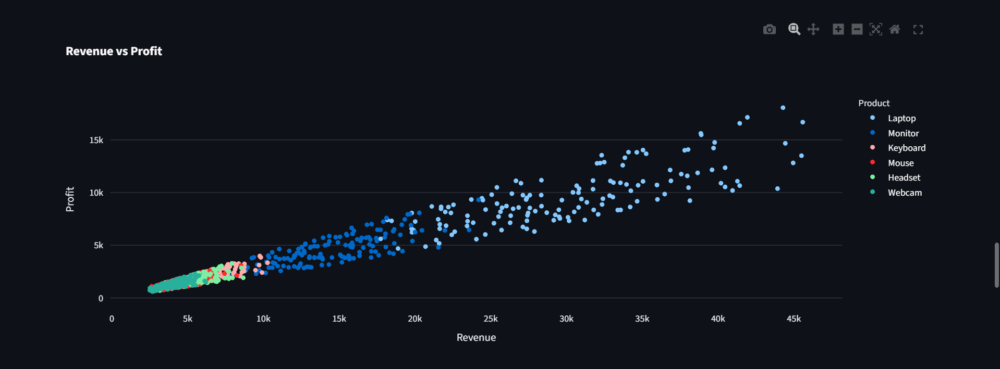
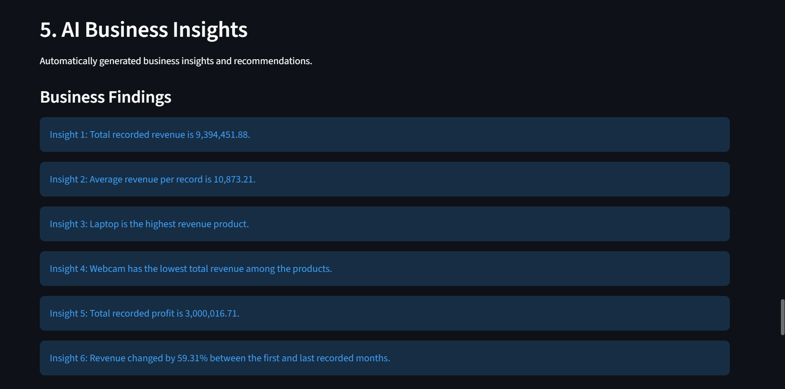
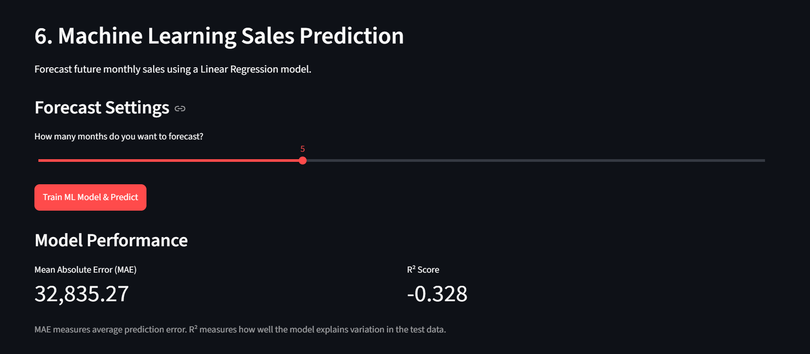
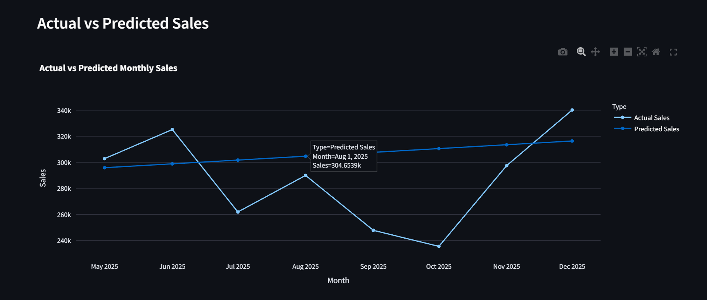
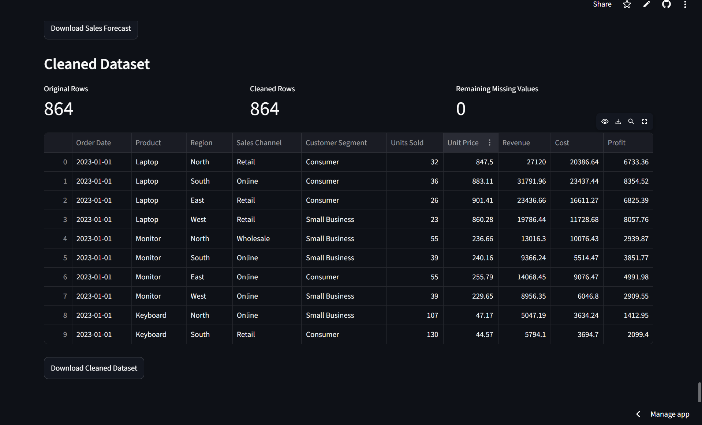

# AI-Powered Business Intelligence Dashboard (https://ai-business-intelligence-dashboard-ca7et9pphdrrjtppfkpd4l.streamlit.app/)
 b0bca84 (Update project README)

An interactive Business Intelligence application built using
Python, Streamlit, Pandas, Plotly, and Scikit-learn.

## Features
- CSV and Excel upload
- Data cleaning
- Business analytics
- Interactive visualizations
- Business insights
- ML-based sales forecasting
- Downloadable reports

## Tech Stack
Python | Streamlit | Pandas | NumPy |
Plotly | Scikit-learn

## Run Locally

```bash
pip install -r requirements.txt
streamlit run app.py

## 📸 Project Screenshots

### Dashboard Overview


### Data Cleaning


### Business analytics



### AI- Business Insights


### AI- Generated Recommendation


### ML Sales Prediction





## Author

**Kshitij Jawade**

Information Technology Student

**Skills & Interests:**
- Artificial Intelligence
- Machine Learning
- Data Analytics
- Data Science
- Python Development

**GitHub:** 
https://github.com/2kshitis

**LinkedIn:**
https://www.linkedin.com/in/kshitij-jawade-064064327/
